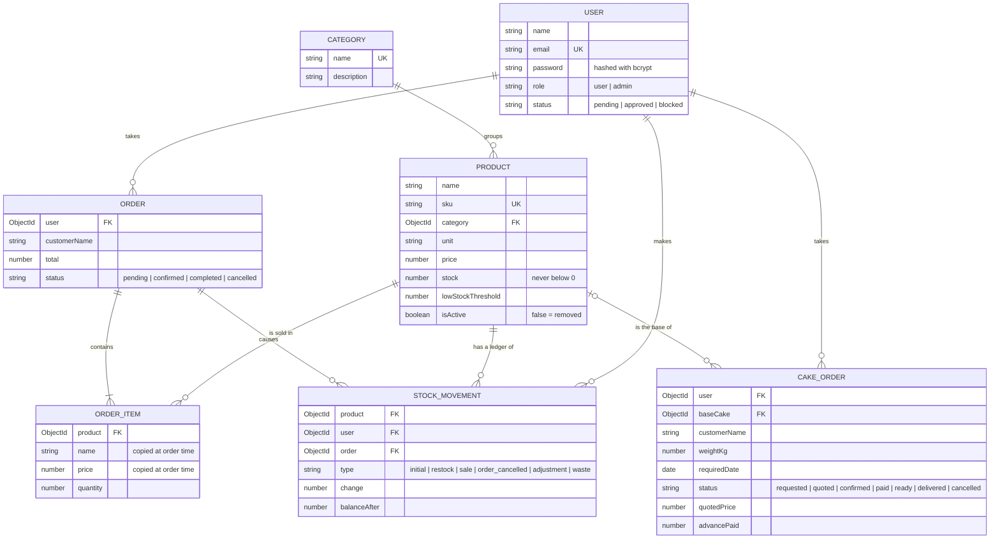

# Bread & More: Bakery Inventory, Orders and Special Cakes

A full-stack MERN app (MongoDB, Express, React, Node.js) for **Bread & More**, a bakery that sells breads, biscuits, pastries, cakes, burgers, sandwiches and savouries (patties, croquettes, rissois, samosas), and takes **special cake orders**. Counter staff take orders, the admin controls the stock, and the stock numbers stay correct.

- **Live website (Vercel):** https://bread-n-more.vercel.app
- **Live API (Railway):** https://bread-n-more-production.up.railway.app/api/health
- **GitHub:** https://github.com/mariadesousasfx71-source/bread-n-more

## Roles

| Role | What they can do |
|---|---|
| **User** (counter staff) | Register (the account waits for approval), log in once approved, browse the products, place orders for customers, take special-cake requests, see and cancel their own pending orders |
| **Admin** | Everything below, plus: manage categories and products, add or remove stock and read the stock history, approve or block staff, see all orders (date filter), set cake prices and move cake orders along, see the dashboard (low stock, revenue, best sellers, sales by category) |

## Test logins (for the examiner)

| Role | Email | Password |
|---|---|---|
| Admin | `admin@breadandmore.com` | `BreadAdmin2026` |
| User | `staff@breadandmore.com` | `Staff12345` |
| User 2 | `staff2@breadandmore.com` | `Staff54321` |

## Run it on your computer

```
cd server
npm install
copy .env.example .env      (Mac/Linux: cp .env.example .env)   then fill in .env
npm run seed
npm run dev

cd client
npm install
copy .env.example .env      (Mac/Linux: cp .env.example .env)
npm run dev
```

Website: http://localhost:5173 · API: http://localhost:4000/api/health

## Data model (six collections and how they link)



All collections have `createdAt` and `updatedAt` (`timestamps: true`).

## Stock rules

1. An order takes its items off the stock **when it is placed**, with one atomic MongoDB update per product (`findOneAndUpdate` with the condition `stock >= quantity`). Two staff members selling the last loaf at the same moment cannot both succeed.
2. If any product in an order is short, the whole order is refused (`400`) and the stock already taken is put back.
3. Cancelling an order (the owner while pending, or an admin while pending or confirmed) puts the items back. The status change is atomic, so the stock is never restored twice.
4. The admin can add or remove stock by hand (a bake, unsold goods). Removing more than there is gives `400`.
5. **Every stock change writes a line in the stock ledger** (`StockMovement`): the change, the stock after it, who did it, and the order if there was one.
6. Removing a product only hides it (`isActive: false`). A category with products cannot be deleted (`409`).
7. **Special cakes are made to order, so they do not touch the stock.** They need 2 days notice, and go `requested` → `quoted` → `confirmed` → `paid` → `ready` → `delivered` (`paid` is the admin marking the full price as paid; it can be skipped).

## API

Every route starts with `/api`. "Logged in" routes need the header `Authorization: Bearer <token>` from `POST /api/auth/login`.

| Method | Address | Who | What it does | Success | Errors |
|---|---|---|---|---|---|
| GET | `/health` | anyone | Is the server running? | 200 | |
| POST | `/auth/register` | anyone | Create a staff account (pending) | 201 | 400, 409, 429 |
| POST | `/auth/login` | anyone | Log in, returns a token | 200 | 400, 401, 403, 429 |
| GET | `/auth/me` | logged in | Who am I? | 200 | 401, 403 |
| GET | `/users` | admin | List staff (`status`, `search`, `page`, `limit`) | 200 | 401, 403 |
| PATCH | `/users/:id/status` | admin | Approve or block a person | 200 | 400, 403, 404 |
| GET | `/categories` | logged in | Categories with their product counts | 200 | 401, 403 |
| POST | `/categories` | admin | Add a category | 201 | 400, 403, 409 |
| PUT | `/categories/:id` | admin | Edit a category | 200 | 400, 403, 404, 409 |
| DELETE | `/categories/:id` | admin | Delete an empty category | 200 | 403, 404, 409 |
| GET | `/products` | logged in | List (`page`, `limit`, `search`, `category`, `stock`, `sort`) | 200 | 400, 401, 403 |
| GET | `/products/low-stock` | admin | Products at or below their low-stock level | 200 | 401, 403 |
| GET | `/products/:id` | logged in | One product | 200 | 400, 404 |
| GET | `/products/:id/movements` | admin | The stock ledger of a product | 200 | 403, 404 |
| POST | `/products` | admin | Add a product (form with photo) | 201 | 400, 403, 409 |
| PUT | `/products/:id` | admin | Edit a product | 200 | 400, 403, 404, 409 |
| PATCH | `/products/:id/stock` | admin | Add or remove stock (`change`, `reason`) | 200 | 400, 403, 404 |
| DELETE | `/products/:id` | admin | Remove from the shop (soft delete) | 200 | 403, 404 |
| POST | `/orders` | logged in | Place an order (checks and takes stock) | 201 | 400, 404 |
| GET | `/orders/mine` | logged in | My order history (`status`, `from`, `to`, `page`) | 200 | 400 |
| GET | `/orders` | admin | All orders (`status`, `from`, `to`, `search`, `page`) | 200 | 400, 403 |
| GET | `/orders/:id` | owner or admin | One order | 200 | 403, 404 |
| PATCH | `/orders/:id/cancel` | owner | Cancel my pending order | 200 | 400, 403, 404 |
| PATCH | `/orders/:id/status` | admin | Confirm, complete or cancel | 200 | 400, 403, 404 |
| POST | `/cake-orders` | logged in | Take a special-cake request | 201 | 400 |
| GET | `/cake-orders/mine` | logged in | My cake requests | 200 | 400 |
| GET | `/cake-orders` | admin | The baking list (`status`, `from`, `to`, `search`) | 200 | 400, 403 |
| GET | `/cake-orders/:id` | owner or admin | One cake order | 200 | 403, 404 |
| PATCH | `/cake-orders/:id/quote` | admin | Set or change the price | 200 | 400, 403, 404 |
| PATCH | `/cake-orders/:id/accept` | owner | The customer agreed; note the advance | 200 | 400, 403, 404 |
| PATCH | `/cake-orders/:id/status` | admin | Mark paid, ready, delivered or cancelled | 200 | 400, 403, 404 |
| PATCH | `/cake-orders/:id/advance` | admin | Record more advance money | 200 | 400, 403, 404 |
| PATCH | `/cake-orders/:id/cancel` | owner | Cancel before it is confirmed | 200 | 400, 403, 404 |
| GET | `/reports/summary` | admin | Dashboard numbers | 200 | 403 |
| GET | `/reports/daily-revenue` | admin | Orders and revenue per day | 200 | 400, 403 |
| GET | `/reports/top-products` | admin | Best sellers (`from`, `to`, `limit`) | 200 | 400, 403 |
| GET | `/reports/sales-by-category` | admin | Revenue per category (joins orders, products and categories) | 200 | 400, 403 |

Lists reply with `{ success, data, pagination: { page, limit, total, totalPages } }`. Errors reply with `{ success: false, message }`.

## Security

- Passwords are hashed with bcrypt. Login uses a JWT that carries the user's id and role.
- `401` = not logged in or token invalid. `403` = logged in but not allowed (wrong role, or account pending or blocked).
- The role is checked on the **server** for every admin route. Hiding links in the website is only for convenience.
- CORS only allows the website listed in `CLIENT_URL`. Login and register are rate limited. `.env` is never committed.
- One central error handler: no stack traces are ever sent to the browser.
